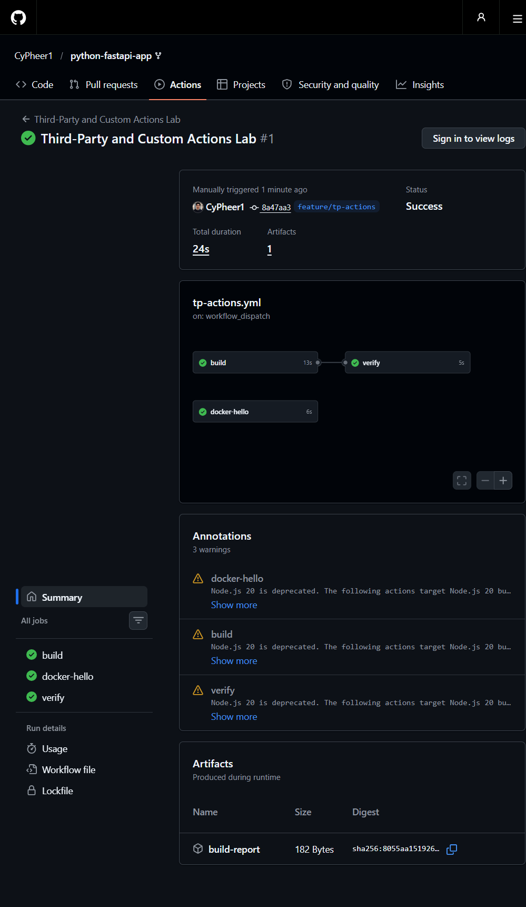

# Réponses au TP7

## Q1

`actions/checkout` n'a pas besoin de `with` pour cette utilisation, car ses paramètres utiles sont optionnels et ses valeurs par défaut permettent déjà de récupérer le dépôt. `actions/setup-node` utilise `with` pour fournir explicitement le paramètre `node-version: 20`.

## Q2

Les jobs GitHub Actions utilisent des environnements isolés sur des runners différents. Les fichiers générés dans `build` ne sont pas automatiquement visibles dans `verify`. Il faut les transférer avec `actions/upload-artifact@v4`, puis les récupérer dans `verify` avec `actions/download-artifact@v4`.

## Q6

`actions/checkout` doit s'exécuter avant une action locale afin que les fichiers du dépôt soient présents sur le runner. Une action locale située sous `.github/actions/` est lue depuis le workspace récupéré par checkout.

## Q7

Dans une action composite, chaque step `run` doit déclarer son shell avec `shell: bash`, car GitHub ne peut pas déduire automatiquement quel interpréteur utiliser pour cette step locale.

## Informations relevées sur actions/setup-node

- Badge Marketplace : « Verified » — créateur vérifié comme organisation partenaire officielle.
- Nombre d'étoiles du dépôt : environ 5 000 étoiles.
- Code source : principalement dans le dossier `src/`, avec le code compilé distribué dans `dist/`.

## Capture de l'exécution réussie

