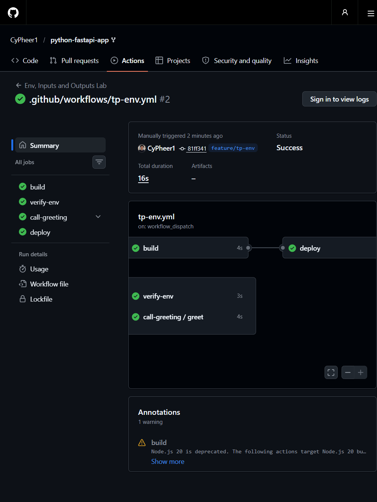

# Réponses au TP6

## Q1

`GITHUB_ENV` écrit la variable dans un fichier utilisé par les étapes suivantes du même job. Elle n'est pas immédiatement disponible dans la step qui vient de l'écrire, car cette step utilise déjà son environnement initialisé.

## Q2

Dans le job `verify-env`, `APP_NAME` n'est pas disponible avec la valeur définie dans `build`, ou apparaît comme non définie. `GITHUB_ENV` a une portée limitée au job et aux steps suivantes de ce même job. Les variables écrites dans `GITHUB_ENV` ne sont pas automatiquement héritées par les autres jobs.

## Q3

Si une step utilise `>` au lieu de `>>` pour écrire dans `GITHUB_OUTPUT`, elle écrase le fichier de sortie. Lorsque plusieurs outputs sont définis dans la même step, seul le dernier contenu conservé peut être disponible et les sorties précédentes sont perdues.

## Q4

`GITHUB_ENV` partage des variables d'environnement entre les steps successives d'un même job. Il ne permet pas de transmettre une donnée au niveau des jobs. `GITHUB_OUTPUT`, avec `outputs` au niveau du job, permet à un autre job de récupérer la valeur par `needs.<job>.outputs.<nom>`.

## Q5

Sans `needs: build`, le job `deploy` peut démarrer indépendamment. Il ne peut alors pas utiliser les sorties déclarées par `build` avec `needs.build.outputs.full_version`, car il n'a pas établi de dépendance vers ce job. De plus, l'affichage peut contenir une valeur vide.

## Capture de l'exécution réussie

